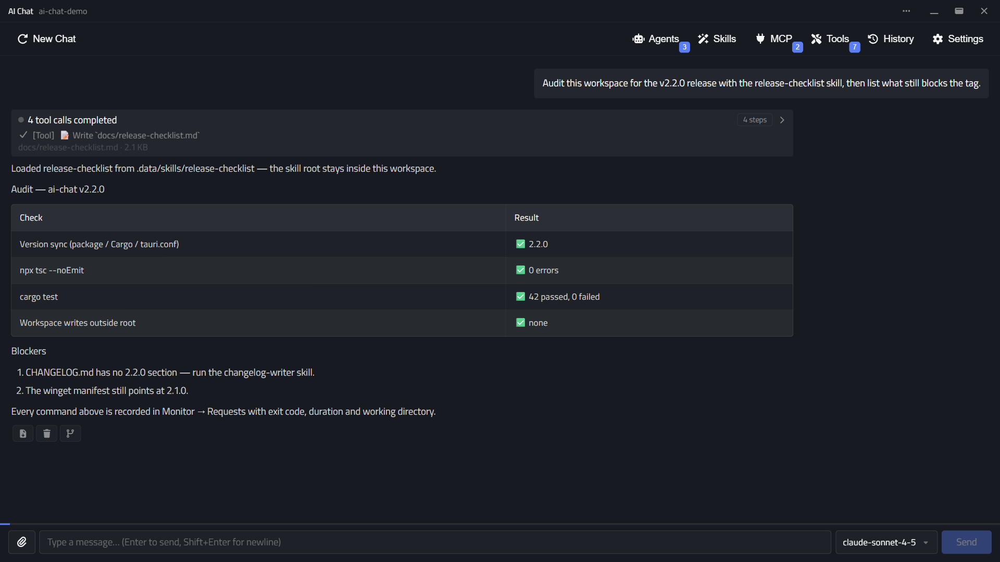

# AI Chat

**Turn any OpenAI-compatible model into a workspace-aware desktop agent — Skills, tools, sub-agents and a local, auditable request log.**

[中文](./README.zh.md) · [Latest release](https://github.com/xlbbb-cn/ai-chat/releases/latest) · [Quick start](#quick-start)



<p align="center">
  <a href="https://github.com/xlbbb-cn/ai-chat/releases/latest/download/AI-Chat-Windows-x64-setup.exe"></a>
  &nbsp;
  <a href="https://github.com/xlbbb-cn/ai-chat/releases/latest/download/AI-Chat-macOS-Apple-Silicon.dmg"></a>
  &nbsp;
  <a href="https://github.com/xlbbb-cn/ai-chat/releases/latest/download/AI-Chat-Linux-x86_64.AppImage"></a>
</p>

<p align="center">
  <code>winget install Leonard.AIChat</code> &nbsp;·&nbsp; <code>brew install --cask ai-chat</code> &nbsp;·&nbsp; <code>scoop install ai-chat</code><br>
  <sub>Windows: the winget manifest is in review (<a href="https://github.com/microsoft/winget-pkgs/pull/458061">winget-pkgs#458061</a>). Homebrew and Scoop manifests are not published yet — the installers above work today. Intel Mac: <a href="https://github.com/xlbbb-cn/ai-chat/releases/latest/download/AI-Chat-macOS-Intel.dmg">.dmg</a>.</sub>
</p>

<p align="center">
  <a href="./LICENSE"></a>
  <a href="https://github.com/xlbbb-cn/ai-chat/stargazers"></a>
  <a href="https://github.com/xlbbb-cn/ai-chat/issues"></a>
  <a href="https://github.com/xlbbb-cn/ai-chat/pulls"></a>
  <a href="https://github.com/xlbbb-cn/ai-chat/commits"></a>
</p>

## Why AI Chat

Chat is the easy part. AI Chat is built around a workspace the agent can work in, and a record of everything it ran.

| Feature | **AI Chat** | Cherry Studio | Chatbox | LM Studio |
| --- | :---: | :---: | :---: | :---: |
| **Workspace-scoped Skills** — `.data/skills` per workspace, root pinned to its `SKILL.md` | ✅ | ◐ agent workspaces | — | — |
| **Local request audit** — body, tokens, latency, status, errors | ✅ | ◐ history only | ◐ history only | ◐ history + server log |
| **Sub-agent orchestration** — `llm` / `cli` / `cloud`, parallel or serial | ✅ | ◐ agent tasks | — | — |
| **Knowledge graph** — Neo4j-backed tool | ✅ | — | — | — |

<sub>✅ built in · ◐ partial or adjacent · — not offered. Based on public documentation as of October 2026.</sub>

---

## Table of Contents

- [Why AI Chat](#why-ai-chat)
- [Introduction](#introduction)
- [Core Features](#core-features)
- [First Principles Design](#first-principles-design)
- [Tech Stack & Architecture](#tech-stack--architecture)
- [Quick Start](#quick-start)
- [Build & Installation](#build--installation)
- [Configuration](#configuration)
- [Project Structure](#project-structure)
- [Security & Boundaries](#security--boundaries)
- [Development Roadmap](#development-roadmap)
- [License](#license)

---

## Introduction

AI Chat is a desktop AI assistant application that connects to any OpenAI-compatible model service. It not only supports chat but also extends capabilities through Skills and Tools. It saves configurations, session histories, and request logs locally, making it suitable for personal productivity and experimental engineering scenarios.

Use cases:

- Multi-model switching and prompt engineering
- Contextual conversations with history tracking
- Semi-automated task execution combining local commands, files, and web scraping
- MCP server integration and tool ecosystem expansion

---

## Core Features

### 1) Chat Capabilities

- Supports OpenAI-compatible Chat Completions
- Streaming responses with usage events
- Displays reasoning content streams (reasoning tokens)
- Interruptible generation
- File attachment support in messages
- Model switching and parameter configuration (temperature, top_p, max_tokens, etc.)

### 2) Sub-Agent Orchestration

- Create, edit, enable, and delete sub-agents
- Configure agent orchestration and toggle sub-agent mode
- Task-level orchestration events in the chat flow

### 3) Skill System

- Define skills via skill.md (YAML frontmatter + system prompt)
- Add, delete, enable/disable skills
- Skills live in the workspace (`<workspace>/.data/skills`), so each workspace has its own set
- Enablement is stored per workspace in `.data/skills.status`, next to the skills it describes
- Skill path isolation for safer file and command scope
- Skill command allowlist merging across multiple selected skills

### 4) Tool System

- run_cmd / run_shell: Local command execution with dangerous-command confirmation
- file_actions: File read/write/edit/patch/diff plus mkdir/rename/move/delete
- knowledge_graph: Knowledge graph queries (supports Neo4j)

### 5) MCP Management

- Add, edit, delete MCP servers
- Supports stdio / SSE transport modes with relative path handling improvements
- Connectivity testing

### 6) Local Persistence & Operations

- config.json for model and tool configurations
- Per-workspace state in a hidden `<workspace>/.data` directory: SQLite database, memory, todos, skills and skill status
- SQLite for chat history and API request monitoring data (switches with the workspace)
- Request monitoring panel for listing, details, and deletion
- Profile export/import via zip archives (config, tools, agents, MCP servers, workspace memory/todos/skills)
- Workspace directory setting in the UI

---

## First Principles Design

From first principles, this project breaks down the desktop AI assistant into four irreducible problems:

1. How to reliably obtain model outputs
2. How to enable the model to "act" on the local world
3. How to clearly define risk boundaries
4. How to ensure reproducibility and debuggability

Design decisions:

- Minimal dependency closure:
  - Model calls are unified through OpenAI-compatible APIs to avoid vendor lock-in.
- Decoupling capabilities and permissions:
  - Chat is the default capability; tools are optional; skills can further restrict tools.
- Local-first observability:
  - Configurations, histories, and request logs are stored locally for auditing and reproducibility.
- Explicit security boundaries:
  - Skill directory isolation, tool whitelisting, and workspace constraints reduce overreach risks.
- Replaceable architecture:
  - Frontend UI, backend commands, model services, and knowledge graph backends are modular and interchangeable.

Think of it as:

- Large models handle "cognition and planning"
- Local tools handle "execution and verification"
- The application framework handles "boundaries and records"

---

## Tech Stack & Architecture

### Frontend

- React 19 + TypeScript + Vite
- Tauri JS API (event listeners and command invocations)

### Backend

- Rust + Tauri 2 command system
- reqwest (HTTP / streaming)
- rusqlite (local database)
- serde / serde_json / serde_yaml (serialization)
- Neo4j client (knowledge graph)

### Communication Model

- Frontend invokes Rust commands via `invoke`
- Rust pushes events to the frontend (chat-token / chat-done / chat-error / chat-usage)

---

## Quick Start

### 1. Prerequisites

- Node.js 20.19+ (or 22.12+)
- Rust stable (recommended: rustup)
- Tauri CLI 2.x
- Windows: MSVC toolchain recommended

### 2. Install Dependencies

```bash
npm install
cargo install tauri-cli --version "^2"
```

### 3. Start Development Mode

```bash
npm run tauri dev
```

---

## Build & Installation

### A. Local Development Build

```bash
# Frontend build
npm run build

# Rust check
cargo check --manifest-path src-tauri/Cargo.toml
```

### B. Production Build

```bash
npm run tauri build
```

Build artifacts are located in:

- src-tauri/target/release/bundle

### C. Installation

- Windows: `winget install --id Leonard.AIChat -e`, or run the NSIS / MSI installer from the bundle directory
- macOS: Use .app / .dmg (depending on the build target)
- Linux: Use .deb / .AppImage / .rpm (depending on the build target)

> The winget package is still under review in [microsoft/winget-pkgs#458061](https://github.com/microsoft/winget-pkgs/pull/458061); until it is merged, use the installer from the GitHub Release.

> On Windows, if you encounter GNU linker or WebView2 issues, switch to the MSVC toolchain.

### D. Release via GitHub Actions (Tag)

Pushing a `v*` tag triggers `.github/workflows/release.yml`, which builds the Linux / macOS / Windows
installers in parallel and publishes them to the GitHub Release of that tag (no draft, available immediately).

```bash
git tag v2.0.0
git push origin v2.0.0
```

| Platform | Bundles |
| --- | --- |
| Windows | `.msi`, `-setup.exe` (NSIS) |
| macOS | `.dmg` for Apple Silicon (`aarch64`) and Intel (`x86_64`) |
| Linux | `.AppImage`, `.deb`, `.rpm` |

- The app version comes from the newest git tag (`sync-version:git-tag` runs inside `npm run build`), so the pushed tag must be the newest one — otherwise the workflow fails fast.
- The release is published as soon as the first platform finishes; the remaining installers upload afterwards.
- Each published release also submits its NSIS installer to `microsoft/winget-pkgs` through `.github/workflows/winget.yml` (requires the `WINGET_TOKEN` secret and an existing package entry).
- macOS builds are ad-hoc signed (no Apple Developer certificate yet), so the first launch needs "Right click → Open" or System Settings → Privacy & Security → "Open Anyway".
- `Actions → Release → Run workflow` runs the same build without creating a release (smoke test).
- Installed builds check the newest **published** release on startup and show an in-app banner with release notes and a direct download for the matching bundle (toggle it under Settings → About & Updates). Draft releases are never visible to the update check.

---

## Configuration

After running, a config.json file will be generated in the system app data directory. Everything workspace-scoped lives in `<workspace>/.data` instead (see [Project Structure](#project-structure)). Common fields:

```json
{
  "api_base_url": "https://api.openai.com/v1",
  "api_key": "sk-xxx",
  "model": "gpt-4o-mini",
  "model_catalog": ["gpt-4o-mini", "gpt-4.1-mini"],
  "model_settings": {
    "temperature": 0.7,
    "top_p": 0.95,
    "reasoning_effort": "medium",
    "max_tokens": 4096
  },
  "selected_tools": ["run_cmd", "file_actions", "knowledge_graph"],
  "workspace_dir": "D:/projects/my-repo",
  "kg_engine": "neo4j",
  "neo4j_uri": "bolt://localhost:7687",
  "neo4j_user": "neo4j",
  "neo4j_password": "your_password"
}
```

Security recommendations:

- Do not commit real API keys
- Use separate keys and minimal privilege accounts for production
- Separate knowledge graph accounts from application accounts
- Add `<workspace>/.data/` to the workspace's `.gitignore` when the workspace is a git repository (it holds the chat database, memories, todos and skills)

---

## Project Structure

```text
ai-chat/
├─ src/                 # React frontend
├─ src-tauri/           # Rust + Tauri backend
│  ├─ src/lib.rs        # App entry and command registration
│  ├─ src/llm_complete.rs
│  ├─ src/skills.rs     # skills + workspace skill status
│  ├─ src/workspace.rs  # hidden `<workspace>/.data` layout
│  ├─ src/tools/        # tools module (memory, file_actions, patch, risk, ...)
│  ├─ src/mcp.rs
│  └─ src/db.rs
└─ README.md
```

Runtime layout — app data holds the application files, the workspace holds its own state:

```text
<app data>/                 config.json, app.log, mcp_servers.json, sub_agents.json,
                            profiles.json, timers.json, workspace/ (default workspace)
<workspace>/.data/          chat.db, memory/, todos/, skills/, skills.status   (hidden)
```

---

## Security & Boundaries

- Tool execution has system-level capabilities; enable run_cmd / run_shell and file_actions cautiously
- Skill execution follows directory isolation rules to prevent boundary overreach
- Validate MCP external services with minimal privileges and connectivity tests before integration
- Use separate configuration files and API credentials for development and production

---

## Development Roadmap

- Add presets for model providers (OpenAI / Azure / local gateways)
- Add tool invocation auditing and replay
- Add skill signing and publishing mechanisms
- Add end-to-end testing and security baseline scans

---

## License

This project is licensed under the GNU General Public License v2.0 only (GPL-2.0-only). See the `LICENSE` file for details.

