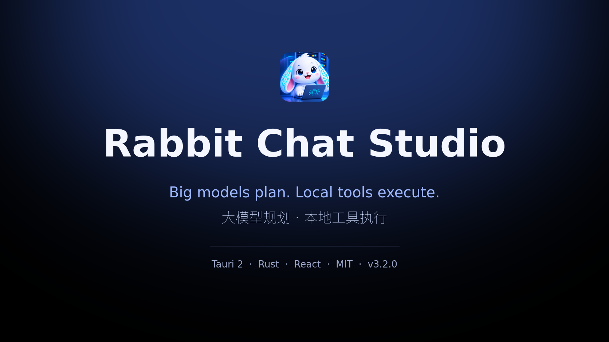

# AI Chat

**Turn any OpenAI-compatible model into a workspace-aware desktop agent — Skills, tools, sub-agents and a local, auditable request log.**

[Wiki](https://github.com/xlbbb-cn/ai-chat/wiki) · [中文](./README.zh.md) · [Latest release](https://github.com/xlbbb-cn/ai-chat/releases/latest) · [Quick start](#quick-start)



<p align="center">
  <a href="https://github.com/xlbbb-cn/ai-chat/releases/latest/download/AI-Chat-Windows-x64-setup.exe"></a>
  &nbsp;
  <a href="https://github.com/xlbbb-cn/ai-chat/releases/latest/download/AI-Chat-macOS-Apple-Silicon.dmg"></a>
  &nbsp;
  <a href="https://github.com/xlbbb-cn/ai-chat/releases/latest/download/AI-Chat-Linux-x86_64.AppImage"></a>
</p>

<p align="center">
  <code>winget install Leonard.AIChat</code> &nbsp;·&nbsp; <code>brew install --cask ai-chat</code> &nbsp;·&nbsp; <code>scoop install ai-chat</code><br>
  <sub>Windows: the winget manifest is in review (<a href="https://github.com/microsoft/winget-pkgs/pull/458061">winget-pkgs#458061</a>). Homebrew and Scoop manifests are not published yet — the installers above work today. Intel Mac: <a href="https://github.com/xlbbb-cn/ai-chat/releases/latest/download/AI-Chat-macOS-Intel.dmg">.dmg</a>.</sub>
</p>

<p align="center">
  <a href="./LICENSE"></a>
  <a href="https://github.com/xlbbb-cn/ai-chat/stargazers"></a>
  <a href="https://github.com/xlbbb-cn/ai-chat/issues"></a>
  <a href="https://github.com/xlbbb-cn/ai-chat/pulls"></a>
  <a href="https://github.com/xlbbb-cn/ai-chat/commits"></a>
</p>

## Why AI Chat

Chat is the easy part. AI Chat gives the agent a workspace, real utilities (memory, timers, todos) and an audit trail — without imposing a persona.

**Core philosophy:** first principles; freedom returned to you (tools, LLM API, prompts); a minimal, professional interface.

| Feature | **AI Chat** | DeepSeek Harness | Cherry Studio | Chatbox | LM Studio |
| --- | :---: | :---: | :---: | :---: | :---: |
| **Skill sandbox** — one skill root per workspace (`.data/skills`), root pinned to its `SKILL.md` | ✅ | ✅ OS-sandboxed workspaces | ◐ agent workspaces | — | — |
| **Self-evolution** — the assistant installs/edits/deletes its own skills, keeps verified facts in a dedicated memory scope | ✅ | ◐ plugin creation via chat | — | — | — |
| **Built-in agent utilities** — 4-level memory (`session` / `user` / `repo` / `evolution`), timers, todos | ✅ | ◐ scheduled tasks | ◐ scheduled tasks | — | — |
| **Agent runtime** — LLM, local CLI or remote cloud, configured in-app | ✅ | ✅ LLM + CLI (delegates to Codex / Claude Code) | ◐ LLM agents | — | — |
| **No account login** — run with just an API key or a local model; no sign-up, no real-name verification | ✅ | ◐ DeepSeek account by default (API key path exists) | ✅ | ✅ | ✅ |
| **Prompt ownership** — no default persona or hidden rewrite; your system message is the base, tool/skill guidance is appended | ✅ | ◐ swappable prompt sections | ◐ assistant prompts | ◐ prompt library | ◐ per-model prompt |
| **Local request audit** — body, tokens, latency, status, errors | ✅ | ✅ append-only session log | ◐ history only | ◐ history only | ◐ history + server log |
| **Background execution** — slow tools, MCP calls and sub-agents keep running while the model works | ✅ | ✅ background tasks | — | — | — |

<sub>✅ built in · ◐ partial or adjacent · — not offered. Based on public documentation as of November 2026. DeepSeek Harness is DeepSeek's open-source agent harness (`dsh`, desktop + web).</sub>

---

## Table of Contents

- [Why AI Chat](#why-ai-chat)
- [Introduction](#introduction)
- [Documentation](#documentation)
- [Core Features](#core-features)
- [First Principles Design](#first-principles-design)
- [Tech Stack & Architecture](#tech-stack--architecture)
- [Quick Start](#quick-start)
- [Build & Installation](#build--installation)
- [Configuration](#configuration)
- [Project Structure](#project-structure)
- [Security & Boundaries](#security--boundaries)
- [Development Roadmap](#development-roadmap)
- [License](#license)

---

## Introduction

AI Chat is a desktop AI assistant application that connects to any OpenAI-compatible model service. It not only supports chat but also extends capabilities through Skills and Tools. It saves configurations, session histories, and request logs locally, making it suitable for personal productivity and experimental engineering scenarios.

Use cases:

- Multi-model switching and prompt engineering
- Contextual conversations with history tracking
- Semi-automated task execution combining local commands, files, and web scraping
- MCP server integration and tool ecosystem expansion

---

## Documentation

Full usage guides live in the GitHub Wiki:

- [English Wiki](https://github.com/xlbbb-cn/ai-chat/wiki) — installation, chat and models, workspace, skills, tools, memory/todos/timers, MCP, sub-agents, prompts and context, configuration/backup, monitoring, updates, security, development and FAQ.
- [简体中文 Wiki](https://github.com/xlbbb-cn/ai-chat/wiki/%E7%AE%80%E4%BD%93%E4%B8%AD%E6%96%87) — complete Simplified Chinese translation of every page.

The repository also carries a one-page [architecture map](docs/architecture.html): the layers, one chat turn and the sub-agent pipeline, drawn as a single self-contained HTML file — open it in any browser, no build step. Regenerate it with `python3 docs/gen.py` when the architecture changes.

---

## Core Features

### 1) Chat Capabilities

- Supports OpenAI-compatible Chat Completions
- Streaming responses with usage events
- Displays reasoning content streams (reasoning tokens)
- Interruptible generation
- File attachment support in messages
- Model switching and parameter configuration (temperature, top_p, max_tokens, etc.)
- **Mid-turn updates**: the composer stays usable while a turn streams — Enter appends your message to the running turn at its next request boundary instead of starting a new one
- No default persona: your system message stays the base; only tool/skill guidance and OS/invocation hints are appended

### 2) Sub-Agent Orchestration

- Three runtimes: `llm` (built-in autonomous loop), `cli` (headless coding CLI on this machine), `cloud` (remote HTTP endpoint)
- **File-backed `llm` definitions**: `agents/<category>/<slug>.md` (YAML frontmatter + prompt). `sub_agents.json` is configuration only. Discovery runs only when you click **Refresh**, which rescans `agents/` and replaces `agents/index.yaml`; the panel reads that manifest, so new files appear after the next refresh. Only `agents/custom/` can be deleted from the panel
- Per-agent model, system prompt, tool/skill allowlist, iteration budget and **MCP opt-in**
- **MCP for `llm` agents** (`enable_mcp`): inject every enabled MCP server's tools using the same names and descriptions as the main agent. Each task starts its own MCP server processes and stops them when the task ends
- Create, edit, enable, and delete sub-agents
- Configure agent orchestration (parallel / sequential, concurrency) and toggle sub-agent mode
- Task-level orchestration events in the chat flow
- With background execution on, `call_subagent` can be dispatched as a background task: the main agent keeps working and the sub-agent report arrives before its next request

### 3) Skill System

- Define skills via skill.md (YAML frontmatter + system prompt)
- Add, delete, enable/disable skills
- **Exactly one skill root** per workspace (`<workspace>/.data/skills`), so each workspace has its own set and there is never a second location
- Enablement is stored per workspace in `.data/skills.status`, next to the skills it describes
- Skill path isolation for safer file and command scope
- Skill command allowlist merging across multiple selected skills
- **Self-evolution mode** lets the assistant install, extend, edit and delete skills itself, with `.bak.n` backups, while forcing the file-actions and memory tools on
- **Memory consolidation** (self-evolution mode): `memory action=consolidate` clusters the hottest `evolution` entries, the model writes one skill from them, and the originals move to `.data/memory/evolution/archive/<skill>/` — the skill is enabled automatically and `phase: restore` brings entries back

### 4) Tool System

Three execution tools with deliberately different scopes:

- `run_cmd`: runs one program the OS resolves through `PATH` (`python`, `python3`, `git`, …) — absolute and relative paths are refused
- `run_shell`: full freedom — the script may `cd` anywhere and run anything, and every script is audited by the risk engine before it runs
- `run_shell` serve: Background processes for the current turn; the whole process tree is stopped and its exit verified when the turn ends
- **Background tool tasks**: `run_cmd`, `run_shell` (`direct`), `file_actions` search, every MCP tool and `call_subagent` accept `run_in_background: true` — the call returns a `bg-…` id immediately, the model keeps working, and the real output is injected as a user message before its next request. The turn is held open until every task settles; the task bar above the composer shows progress with a cancel button, and the model manages them with `background_task` (`list` / `wait` / `get` / `cancel`). Tasks are turn-scoped: Stop or the end of the turn kills their process trees. Global switch: Settings → Runtime & Debug → Background execution (sub-agents never get the flag)
- `file_actions`: read/write/edit/patch/diff plus mkdir/rename/move/delete, strictly inside the workspace (including the hidden `.data` state folder; the workspace database stays protected)
- `memory`: Four scopes (`session` / `user` / `repo` / `evolution`) for searching and persisting conclusions
- `todos`: Per-session task lists the model can plan, update and close
- `timer`: One-shot delay timers that resume the session instead of polling; timers and running turns keep the system awake (Windows / macOS / Linux)

### 5) MCP Management

- Add, edit, delete MCP servers
- Supports stdio / SSE / HTTP / Streamable HTTP transports, with relative path handling improvements
- `llm` sub-agents can opt in with `enable_mcp`: their tools come from every enabled server and keep the main agent's tool names/descriptions
- Each sub-agent task owns its MCP server processes (isolated from the main agent's pool) and stops them when the task ends — success, error, max iterations or Stop
- Connectivity testing

### 6) Local Persistence & Operations

- config.json for model and tool configurations
- Per-workspace state in a hidden `<workspace>/.data` directory: SQLite database, memory, todos, skills, skill status and pending delay timers
- SQLite for chat history and API request monitoring data (switches with the workspace)
- Request monitoring panel for listing, details, and deletion
- Backup export/import via zip archives (config, tools, agents and their `agents/` definitions, MCP servers, workspace memory/todos/skills)
- Extra windows run as shadow instances: each writes only a forked config copy with its own workspace, while the shared config stays with the primary window
- Workspace switching from the titlebar's workspace indicator (recent workspaces plus a folder picker)

---

## First Principles Design

The core intent is simple: reason from first principles, return freedom to the user (tools, LLM API, prompts), and keep the interface minimal and professional.

From first principles, this project breaks down the desktop AI assistant into four irreducible problems:

1. How to reliably obtain model outputs
2. How to enable the model to "act" on the local world
3. How to clearly define risk boundaries
4. How to ensure reproducibility and debuggability

Design decisions:

- Minimal dependency closure:
  - Model calls are unified through OpenAI-compatible APIs to avoid vendor lock-in.
- Decoupling capabilities and permissions:
  - Chat is the default capability; tools are optional; skills can further restrict tools.
- Local-first observability:
  - Configurations, histories, and request logs are stored locally for auditing and reproducibility.
- Explicit security boundaries:
  - Skill directory isolation, tool whitelisting, and workspace constraints reduce overreach risks.
- Replaceable architecture:
  - Frontend UI, backend commands, model services, and knowledge graph backends are modular and interchangeable.

Think of it as:

- Large models handle "cognition and planning"
- Local tools handle "execution and verification"
- The application framework handles "boundaries and records"

---

## Tech Stack & Architecture

### Frontend

- React 19 + TypeScript + Vite
- Tauri JS API (event listeners and command invocations)

### Backend

- Rust + Tauri 2 command system
- reqwest (HTTP / streaming)
- rusqlite (local database)
- serde / serde_json / serde_yaml (serialization)
- neo4rs (Neo4j driver, used only by the standalone `knowledge-graph` crate in `src-tauri/src/utils/knowledge_graph` — not a dependency of the app crate)

### Communication Model

- Frontend invokes Rust commands via `invoke`
- Rust pushes events to the frontend (chat-token / chat-done / chat-error / chat-usage)

The full picture — layers, the request pipeline inside one turn, and the sub-agent flow — is drawn in [docs/architecture.html](docs/architecture.html).

---

## Quick Start

### 1. Prerequisites

- Node.js 20.19+ (or 22.12+)
- Rust stable (recommended: rustup)
- Tauri CLI 2.x
- Windows: MSVC toolchain recommended

### 2. Install Dependencies

```bash
npm install
cargo install tauri-cli --version "^2"
```

### 3. Start Development Mode

```bash
npm run tauri dev
```

---

## Build & Installation

### A. Local Development Build

```bash
# Frontend build
npm run build

# Rust check
cargo check --manifest-path src-tauri/Cargo.toml
```

### B. Production Build

```bash
npm run tauri build
```

Build artifacts are located in:

- src-tauri/target/release/bundle

### C. Installation

- Windows: `winget install --id Leonard.AIChat -e`, or run the NSIS installer from the bundle directory
- macOS: Use .app / .dmg (depending on the build target)
- Linux: Use .deb / .AppImage / .rpm (depending on the build target)

> The winget package is still under review in [microsoft/winget-pkgs#458061](https://github.com/microsoft/winget-pkgs/pull/458061); until it is merged, use the installer from the GitHub Release.

> On Windows, if you encounter GNU linker or WebView2 issues, switch to the MSVC toolchain.

### D. Release via GitHub Actions (Tag)

Pushing a `v*` tag triggers `.github/workflows/release.yml`, which builds the Linux / macOS / Windows
installers in parallel and publishes them to the GitHub Release of that tag (no draft, available immediately).

```bash
git tag v2.0.0
git push origin v2.0.0
```

| Platform | Bundles |
| --- | --- |
| Windows | `-setup.exe` (NSIS) |
| macOS | `.dmg` for Apple Silicon (`aarch64`) and Intel (`x86_64`) |
| Linux | `.AppImage`, `.deb`, `.rpm` |

- The app version comes from the newest git tag (`sync-version:git-tag` runs inside `npm run build`), so the pushed tag must be the newest one — otherwise the workflow fails fast.
- The Release body is filled by the same workflow from the commits between the previous tag and this one (`scripts/gen-changelog.cjs`, grouped by Conventional Commits type), so there are no hand-written release notes.
- `CHANGELOG.md` comes from that script too: run `npm run changelog -- --from <prev-tag> --to <tag> --details --write` before tagging to keep it current.
- The release is published as soon as the first platform finishes; the remaining installers upload afterwards.
- Each published release also submits its NSIS installer to `microsoft/winget-pkgs` through `.github/workflows/winget.yml` (requires the `WINGET_TOKEN` secret and an existing package entry).
- macOS builds are ad-hoc signed (no Apple Developer certificate yet), so the first launch needs "Right click → Open" or System Settings → Privacy & Security → "Open Anyway".
- `Actions → Release → Run workflow` runs the same build without creating a release (smoke test).
- Installed builds check the newest **published** release on startup and show an in-app banner with release notes and a direct download for the matching bundle (toggle it under Settings → About & Updates). Draft releases are never visible to the update check.

---

## Configuration

After running, a config.json file will be generated in the system app data directory. Everything workspace-scoped lives in `<workspace>/.data` instead (see [Project Structure](#project-structure)). Common fields:

```json
{
  "api_base_url": "https://api.openai.com/v1",
  "api_key": "sk-xxx",
  "model": "gpt-4o-mini",
  "model_catalog": ["gpt-4o-mini", "gpt-4.1-mini"],
  "model_settings": {
    "temperature": 0.7,
    "top_p": 0.95,
    "reasoning_effort": "medium",
    "max_tokens": 4096
  },
  "selected_tools": ["run_cmd", "file_actions"],
  "self_evolution_mode": false,
  "background_tools": false,
  "main_agent_max_rounds": 40,
  "main_agent_max_tool_calls": 120,
  "tool_failure_limit": 3,
  "single_instance": true,
  "workspace_dir": "D:/projects/my-repo"
}
```

> `self_evolution_mode: true` lets the assistant evolve its own skills and forces the `file_actions` and `memory` tools on — the app rewrites the selection on every save and on startup, so they cannot be switched off while the mode is active.

Security recommendations:

- Do not commit real API keys
- Use separate keys and minimal privilege accounts for production
- Add `<workspace>/.data/` to the workspace's `.gitignore` when the workspace is a git repository (it holds the chat database, memories, todos and skills)

---

## Project Structure

```text
ai-chat/
├─ src/                 # React frontend
├─ src-tauri/           # Rust + Tauri backend
│  ├─ src/lib.rs        # App entry and command registration
│  ├─ src/llm_complete.rs
│  ├─ src/agents.rs     # sub-agent types, runtime config, missions, orchestration
│  ├─ src/agents/       #   cli.rs, cloud.rs, files.rs (`llm` markdown definitions)
│  ├─ src/skills.rs     # skills + workspace skill status
│  ├─ src/workspace.rs  # hidden `<workspace>/.data` layout
│  ├─ src/tools/        # tools module (memory, file_actions, patch, risk, ...)
│  ├─ src/mcp.rs        # MCP transports; main pool + per-agent AgentMcpSession
│  └─ src/db.rs
├─ docs/                # architecture.html (layers / one turn / sub-agents) + gen.py
└─ README.md
```

Runtime layout — app data holds the application files, the workspace holds its own state:

```text
<app data>/                 config.json, app.log, mcp_servers.json, sub_agents.json,
                            agents/ (llm definitions + index.yaml
                            discovery manifest), shadow/ (per-window config forks),
                            workspace/ (default workspace)
<workspace>/.data/          chat.db, memory/{user,repo,evolution}/, todos/, skills/,
                            skills.status, scripts/ (run_cmd script library),
                            tmp/ (sub-agent deliverables), mcp/ + mcp.conf
                            (self-built MCP servers), timers.json (pending delay
                            timers, per workspace)                                    (hidden)
```

---

## Security & Boundaries

The three execution tools have deliberately different scopes:

| Tool | Where it may reach | How it is bounded |
| --- | --- | --- |
| `file_actions` | Inside the workspace root, including the hidden `.data` folder — the workspace database is the one exception | Path sandbox: outside paths, `../` escapes and symlink escapes are rejected |
| `run_cmd` | One program the OS resolves through `PATH` — a bare name like `python` | Name check, risk assessment L0–L6, confirmation for L0–L3 |
| `run_shell` | Anywhere, including outside the workspace | Risk assessment L0–L6, confirmation for L0–L3, syntax gate |

Other boundaries:

- Skills live in exactly one root per workspace; the skill folder is pinned to its own `SKILL.md`
- Background tool tasks keep every check: risk assessment and confirmation still happen before the task starts, and its output arrives as a user message rather than a tool result
- Self-evolution mode lets the assistant rewrite its own instructions — use it briefly, in a controlled workspace, and inspect the `.bak` files afterwards
- MCP tool arguments are forwarded to the MCP server verbatim and are not sandboxed; `llm` sub-agents only receive MCP tools when `enable_mcp` is on for that agent
- Validate MCP external services with minimal privileges and connectivity tests before integration
- Use separate configuration files and API credentials for development and production

---

## Development Roadmap

- Add presets for model providers (OpenAI / Azure / local gateways)
- Add tool invocation auditing and replay
- Add skill signing and publishing mechanisms
- Add end-to-end testing and security baseline scans

---

## License

This project is licensed under the GNU General Public License v2.0 only (GPL-2.0-only). See the `LICENSE` file for details.

