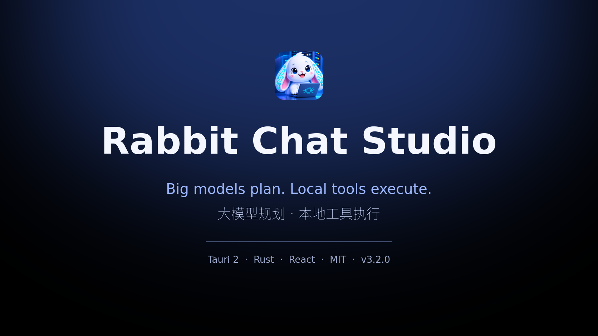

# Rabbit Chat Studio

**把任意 OpenAI 兼容模型变成工作区感知的桌面 Agent —— Skills、工具与 Sub-Agent 开箱即用，每一次请求都留在本机可查。**

[官网](https://xlbbb-cn.github.io/ai-chat/) · [Wiki](https://github.com/xlbbb-cn/ai-chat/wiki) · [English](./README.md) · [Microsoft Store](https://apps.microsoft.com/detail/9MV82J9G95GS) · [最新版本](https://github.com/xlbbb-cn/ai-chat/releases/latest) · [快速开始](#快速开始)



<p align="center">
  <a href="https://github.com/xlbbb-cn/ai-chat/releases/latest/download/Rabbit-Chat-Studio-Windows-x64-setup.exe"></a>
  &nbsp;
  <a href="https://apps.microsoft.com/detail/9MV82J9G95GS"></a>
  &nbsp;
  <a href="https://github.com/xlbbb-cn/ai-chat/releases/latest/download/Rabbit-Chat-Studio-macOS-Apple-Silicon.dmg"></a>
  &nbsp;
  <a href="https://github.com/xlbbb-cn/ai-chat/releases/latest/download/Rabbit-Chat-Studio-Linux-x86_64.AppImage"></a>
</p>

<p align="center">
  <code>Microsoft Store</code> &nbsp;·&nbsp; <code>NSIS .exe</code> &nbsp;·&nbsp; <code>macOS .dmg</code> &nbsp;·&nbsp; <code>Linux .AppImage</code><br>
  <sub>Windows 10 2004+ / 11：从 <a href="https://apps.microsoft.com/detail/9MV82J9G95GS">Microsoft Store</a> 安装，或运行最新 Release 的 NSIS 安装包。winget / Homebrew / Scoop 暂未提供。Intel Mac 请下载 <a href="https://github.com/xlbbb-cn/ai-chat/releases/latest/download/Rabbit-Chat-Studio-macOS-Intel.dmg">.dmg</a>。</sub>
</p>

<p align="center">
  <a href="./LICENSE"></a>
  <a href="https://github.com/xlbbb-cn/ai-chat/stargazers"></a>
  <a href="https://github.com/xlbbb-cn/ai-chat/issues"></a>
  <a href="https://github.com/xlbbb-cn/ai-chat/pulls"></a>
  <a href="https://github.com/xlbbb-cn/ai-chat/commits"></a>
</p>

## 差异点

聊天只是起点。Rabbit Chat Studio 给 Agent 一个工作区、一套真正可用的工具（记忆、定时器、待办），以及可查的执行记录 —— 并且不替用户设定人设。

**核心初衷：** 第一性原理；把自由还给用户（工具、LLM API、提示词）；界面简约、专业。

| 能力 | **Rabbit Chat Studio** | DeepSeek Harness | Cherry Studio | Chatbox | LM Studio |
| --- | :---: | :---: | :---: | :---: | :---: |
| **Skills 沙箱** —— 每个工作区**唯一**的技能根目录 `.data/skills`，根目录锁定在自身 `SKILL.md` | ✅ | ✅ 系统级沙箱工作区 | ◐ Agent 工作区 | — | — |
| **自我进化** —— 助手自行安装/修改/删除技能，并把已验证的关键事实存进专属记忆区 | ✅ | ◐ 对话式创建插件 | — | — | — |
| **内置 Agent 工具** —— 4 级 memory（`session` / `user` / `repo` / `evolution`）、timer、todos | ✅ | ◐ 定时任务 | ◐ 定时任务 | — | — |
| **Agent 运行时** —— LLM、本地 CLI 或远程 cloud，界面内自由配置 | ✅ | ✅ LLM + CLI（可委派 Codex / Claude Code） | ◐ LLM Agent | — | — |
| **无需账户登录** —— 只要一个 API Key 或本地模型即可运行，无注册、实名门槛 | ✅ | ◐ 默认登录 DeepSeek 账号（也可用官方 API Key） | ✅ | ✅ | ✅ |
| **提示词自主** —— 无默认人设、无隐藏改写；你的 system message 是基底，只追加工具/技能说明 | ✅ | ◐ 提示词分区可替换 | ◐ 助手提示词 | ◐ 提示词库 | ◐ 按模型提示词 |
| **本地请求审计** —— 请求体、token、耗时、状态、错误 | ✅ | ✅ 追加式会话日志 | ◐ 仅历史记录 | ◐ 仅历史记录 | ◐ 历史 + 服务端日志 |
| **后台执行** —— 慢工具、MCP 调用与子智能体在模型继续工作时运行 | ✅ | ✅ 后台任务 | — | — | — |

<sub>✅ 原生 · ◐ 部分/相近 · — 未提供；基于 2026 年 11 月的公开文档。DeepSeek Harness 是 DeepSeek 开源的 agent harness（`dsh`，桌面端 + Web）。</sub>

---

## 目录

- [差异点](#差异点)
- [项目介绍](#项目介绍)
- [文档与教程](#文档与教程)
- [核心功能](#核心功能)
- [第一性设计原理](#第一性设计原理)
- [技术栈与架构](#技术栈与架构)
- [快速开始](#快速开始)
- [编译与安装](#编译与安装)
- [配置说明](#配置说明)
- [项目结构](#项目结构)
- [安全与边界](#安全与边界)
- [开发路线建议](#开发路线建议)
- [许可证](#许可证)

---

## 项目介绍

Rabbit Chat Studio 是一个桌面端 AI 助手应用，支持接入任意 OpenAI 兼容模型服务。它不仅能聊天，还能通过技能（Skills）和工具（Tools）扩展能力，并且在本地保存配置、历史会话与请求日志，适合个人效率场景与工程化实验场景。

适用场景：

- 多模型切换与提示词实验
- 带上下文的持续对话与历史回溯
- 结合本地命令、文件、网页抓取的半自动任务执行
- MCP 服务接入与工具生态扩展

---

## 文档与教程

完整使用教程在 GitHub Wiki：

- [English Wiki](https://github.com/xlbbb-cn/ai-chat/wiki) — 英文主站，包含安装、聊天与模型、工作区、技能、工具、记忆/待办/定时器、MCP、子智能体、提示词与上下文、配置与备份、监控、更新、安全、开发构建和常见问题。
- [简体中文 Wiki](https://github.com/xlbbb-cn/ai-chat/wiki/%E7%AE%80%E4%BD%93%E4%B8%AD%E6%96%87) — 每个页面的完整简体中文对照。

此外，仓库内附有一页[架构图](docs/architecture.html)：分层结构、一次对话轮的请求流水线、子智能体编排，单个自包含 HTML 文件，双击即可在浏览器里打开，无需构建。架构变动后运行 `python3 docs/gen.py` 重新生成。

---

## 核心功能

### 1) 对话能力

- 支持 OpenAI 兼容 Chat Completions
- 支持流式返回与 usage 事件
- 支持推理内容流（reasoning token）展示
- 支持中断生成
- 支持消息文件附件展示
- 支持模型切换与模型参数配置（temperature、top_p、max_tokens 等）
- **回合内追加**：生成过程中输入框保持可用，回车会把你的消息追加到正在进行的回合，在下一个请求边界送达，而不是另起一轮
- 无默认人设：system message 作为基底，只追加工具/技能说明与系统/调用提示

### 2) 子代理编排（Sub-Agents）

- 三种运行时：`llm`（内置自主循环）、`cli`（本机无头编码 CLI）、`cloud`（远程 HTTP 端点）
- **文件化的 `llm` 定义**：`agents/<分类>/<slug>.md`（YAML frontmatter + 提示词）。`sub_agents.json` 只作为配置。**只有点击 Refresh 时才会发现新文件**：扫描 `agents/` 并替换 `agents/index.yaml`，面板读取该清单；新文件需要下次刷新后才出现。面板只允许删除 `agents/custom/` 下的文件
- 每个 Agent 可单独配置模型、系统提示词、工具/技能白名单、迭代预算与 **MCP 开关**
- **llm Agent 的 MCP**（`enable_mcp`）：注入所有已启用 MCP server 的工具，工具名与描述和主 Agent 完全一致；每个任务启动自己的 MCP server 进程，任务结束后退出
- 支持子代理新增、编辑、启用与删除
- 支持编排配置（并行 / 串行、并发数）与子代理模式开关
- 对话中支持任务级编排事件
- 开启后台执行后，`call_subagent` 也可以作为后台任务派发：主 Agent 继续工作，子 Agent 的报告在其下一次请求前送达

### 3) 技能系统（Skills）

- 基于 skill.md（YAML frontmatter + system prompt）定义技能
- 支持技能的新增、删除、启用/停用
- 每个工作区**有且只有一个**技能根目录（`<workspace>/.data/skills`），各自独立一套，不存在第二个位置
- 启用状态按工作区保存在 `.data/skills.status`，与技能本体同目录
- 技能目录隔离，约束文件与命令作用范围
- 多技能下命令白名单可合并
- **自我进化模式**允许助手自行安装、扩展、修改和删除技能（自动生成 `.bak.n` 备份），同时强制打开文件操作与记忆工具
- **记忆整合**（自我进化模式）：`memory action=consolidate` 把占用上下文最多的 `evolution` 条目聚类，由模型写成一个技能，原条目移入 `.data/memory/evolution/archive/<skill>/`；技能自动启用，`phase: restore` 可把条目移回

### 4) 工具系统（Tools）

三个执行工具的作用域刻意不同：

- run_cmd：只运行由系统通过 `PATH` 解析的程序（`python`、`python3`、`git` 等），绝对路径与相对路径一律拒绝
- run_shell：完全自由——脚本可以 `cd` 到任何地方执行任何内容，但每个脚本执行前都会经过风险引擎审计
- run_shell serve：当前回合的后台进程；回合结束时整棵进程树会被停止并核验退出
- **后台工具任务**：`run_cmd`、`run_shell`（`direct`）、`file_actions` 搜索、所有 MCP 工具与 `call_subagent` 都支持 `run_in_background: true`——调用立即返回 `bg-…` 任务 id，模型继续工作，真实结果会在其下一次请求前以 user 消息送达。回合会一直保持到所有任务结束；输入框上方的任务条显示进度并可取消，模型侧用 `background_task`（`list` / `wait` / `get` / `cancel`）管理。任务属于当前回合：Stop 或回合结束会杀掉它们的进程树。总开关：设置 → 运行时与调试 → 后台执行（子智能体不会收到该参数）
- file_actions：文件读写、编辑、补丁、比对（diff），支持 mkdir / rename / move / delete；严格限制在工作区内（包含隐藏的 `.data` 状态目录，工作区数据库受保护）
- memory：`session` / `user` / `repo` / `evolution` 四级记忆，可检索与沉淀结论
- todos：按会话维护任务清单，模型可规划、更新与关闭
- timer：一次性延时定时器，到点自动恢复会话，无需轮询；定时器挂起与回合进行中会阻止系统休眠（Windows / macOS / Linux）

### 5) MCP 管理

- 支持 MCP Server 的增删改查
- 支持 stdio / SSE / HTTP / Streamable HTTP 四种传输模式，并改进相对路径处理
- llm 子代理可通过 `enable_mcp` 开启：工具来自所有已启用的 server，名称/描述与主 Agent 一致
- 每个子代理任务独立维护 MCP server 进程（与主 Agent 进程池隔离），任务结束（成功 / 失败 / 达到迭代上限 / Stop）后自动退出
- 支持连通性测试

### 6) 本地持久化与运维

- config.json 保存模型与工具配置
- 工作区状态存放在隐藏目录 `<workspace>/.data`：SQLite 数据库、记忆、待办、技能、技能状态与挂起的延时定时器
- SQLite 保存聊天历史与 API 请求监控数据（随工作区切换）
- 请求监控面板支持列表、详情与删除
- 支持通过 zip 导出/恢复 Profile（配置、工具、智能体及其 `agents/` 定义、MCP 服务、工作区记忆/待办/技能）
- 多窗口以「影子实例」运行：每个窗口只写自己分叉的配置副本并使用独立的工作区，共享配置始终属于主窗口
- 支持在设置中管理工作目录

---

## 第一性设计原理

核心初衷很简单：从第一性原理出发，把自由还给用户（工具、LLM API、提示词），并保持界面简约、专业。

从第一性出发，本项目将桌面 AI 助手拆解为四个不可再简化的基本问题：

1. 如何稳定获得模型输出
2. 如何让模型对本地世界“有手有脚”
3. 如何把风险边界明确化
4. 如何保证可复现与可调试

对应设计决策如下：

- 最小依赖闭环：
  - 模型调用统一走 OpenAI 兼容接口，避免供应商锁定。
- 能力与权限解耦：
  - 对话是默认能力，工具是可选能力；技能可进一步限制工具。
- 本地优先可观察：
  - 配置、历史、请求日志落地本地，方便审计与复现。
- 安全边界显式化：
  - 技能目录隔离、工具白名单、工作目录约束，降低越权风险。
- 架构可替换：
  - 前端 UI、后端命令、模型服务、知识图谱后端均可替换，不耦合单点实现。

你可以把它理解为：

- 大模型负责“认知与规划”
- 本地工具负责“执行与验证”
- 应用框架负责“边界与记录”

---

## 技术栈与架构

### 前端

- React 19 + TypeScript + Vite
- Tauri JS API（事件监听与命令调用）

### 后端

- Rust + Tauri 2 命令系统
- reqwest（HTTP / 流式）
- rusqlite（本地数据库）
- serde / serde_json / serde_yaml（序列化）
- neo4rs（Neo4j 驱动，仅供 `src-tauri/src/utils/knowledge_graph` 下独立的 `knowledge-graph` 包使用，不是主 crate 的依赖）

### 通信模型

- 前端 invoke 调用 Rust 命令
- Rust 通过事件向前端推送 chat-token / chat-done / chat-error / chat-usage

这三层背后的完整关系 —— 分层、一次对话轮内部的请求流水线、子智能体编排 —— 都画在 [docs/architecture.html](docs/architecture.html)。

---

## 快速开始

### 1. 环境要求

- Node.js 20.19+（或 22.12+）
- Rust stable（建议 rustup 管理）
- Tauri CLI 2.x
- Windows 建议使用 MSVC 工具链

### 2. 安装依赖

```bash
npm install
cargo install tauri-cli --version "^2"
```

### 3. 启动开发模式

```bash
npm run tauri dev
```

---

## 编译与安装

### A. 本地开发编译

```bash
# 前端构建
npm run build

# Rust 检查
cargo check --manifest-path src-tauri/Cargo.toml
```

### B. 生产构建

```bash
npm run tauri build
```

构建产物位于：

- src-tauri/target/release/bundle

### C. 安装方式

- Windows（Microsoft Store）：[apps.microsoft.com/detail/9MV82J9G95GS](https://apps.microsoft.com/detail/9MV82J9G95GS) —— 由商店安装并负责更新。商店版是 MSIX 包，应用配置被重定向到 `%LOCALAPPDATA%\Packages\XLBBB.RabbitChatStudio\LocalCache`，与 NSIS 版不共享；工作区里的 `.data` 两个版本共用。
- Windows（安装包）：运行最新 Release / bundle 目录中的 NSIS 安装包
- macOS：使用 .app / .dmg（按构建目标）
- Linux：使用 .deb / .AppImage / .rpm（按构建目标）

> 暂时没有包管理器渠道：winget、Homebrew、Scoop 清单都还没发布，请用上面的 Microsoft Store 或 NSIS 安装包。

> Windows 上如果遇到 GNU linker 与 WebView2 相关问题，建议切换到 MSVC 工具链构建。

### D. 用 GitHub Actions 发布（打 Tag）

推送 `v*` 标签后会触发 `.github/workflows/release.yml`，并行构建 Linux / macOS / Windows 安装包，
并直接发布到该标签对应的 GitHub Release（非草稿，构建完成即可下载）。

```bash
git tag v2.0.0
git push origin v2.0.0
```

| 平台 | 产物 |
| --- | --- |
| Windows | `-setup.exe`（NSIS） |
| macOS | `.dmg`（Apple Silicon `aarch64` 与 Intel `x86_64` 各一份） |
| Linux | `.AppImage`、`.deb`、`.rpm` |

- 版本号取自最新的 git tag（`npm run build` 内部会执行 `sync-version:git-tag`），因此本次推送的 tag 必须是最新 tag，否则流程会直接失败提示。
- Release 在第一个平台构建完成时就会发布，其余平台的安装包随后陆续上传。
- `.github/workflows/winget.yml` 先留着但不生效：要等包被 `microsoft/winget-pkgs` 接受（之前那个 PR 已关闭）并配好 `WINGET_TOKEN` secret 才能提交。
- macOS 产物为 ad-hoc 签名（暂无 Apple 开发者证书），首次打开需要在「系统设置 → 隐私与安全性」选择「仍要打开」，或右键 App → 打开。
- 也可在 `Actions → Release → Run workflow` 手动触发，只构建不创建 Release（用于验证流程）。
- 已安装的旧版本会在启动时检查最新**已发布**的 Release，并在应用内提示新版本、展示更新说明、直接下载匹配当前系统的安装包（可在「设置 → About & Updates」关闭）。草稿状态的 Release 不会被检查到。
- 商店版走商店自己的更新通道：可执行文件位于 `\WindowsApps\` 时，应用内检查直接返回「已是最新」（`update::is_store_packaged`），不会把用户引到 GitHub 再装第二份。

---

## 配置说明

运行后会在系统应用数据目录生成配置文件 config.json；所有随工作区的数据则存放在 `<workspace>/.data`（见「项目结构」），常见字段：

```json
{
  "api_base_url": "https://api.openai.com/v1",
  "api_key": "sk-xxx",
  "model": "gpt-4o-mini",
  "model_catalog": ["gpt-4o-mini", "gpt-4.1-mini"],
  "model_settings": {
    "temperature": 0.7,
    "top_p": 0.95,
    "reasoning_effort": "medium",
    "max_tokens": 4096
  },
  "selected_tools": ["run_cmd", "file_actions"],
  "self_evolution_mode": false,
  "background_tools": false,
  "main_agent_max_rounds": 40,
  "main_agent_max_tool_calls": 120,
  "tool_failure_limit": 3,
  "single_instance": true,
  "workspace_dir": "D:/projects/my-repo"
}
```

> `self_evolution_mode: true` 允许助手自行演进技能，并**强制打开** `file_actions` 与 `memory` 两个工具——应用每次保存与每次启动都会重写这份选择，模式开启期间无法把它们关掉。

安全建议：

- 不要提交真实 API Key
- 生产环境使用独立密钥与最小权限账号
- 若工作区本身是 git 仓库，把 `<workspace>/.data/` 加入 `.gitignore`（其中包含聊天数据库、记忆、待办与技能）

---

## 项目结构

```text
rabbit-chat-studio/
├─ src/                 # React 前端
├─ src-tauri/           # Rust + Tauri 后端
│  ├─ src/lib.rs        # 应用入口与命令注册
│  ├─ src/llm_complete.rs
│  ├─ src/agents.rs     # 子代理类型、运行配置、任务状态与编排
│  ├─ src/agents/       #   cli.rs、cloud.rs、files.rs（llm 的 Markdown 定义）
│  ├─ src/skills.rs     # 技能解析 + 工作区技能状态
│  ├─ src/workspace.rs  # 隐藏目录 `<workspace>/.data` 布局
│  ├─ src/tools/        # 工具模块（memory / file_actions / patch / risk 等）
│  ├─ src/mcp.rs        # MCP 传输；主进程池 + 每个任务的 AgentMcpSession
│  └─ src/db.rs
├─ docs/                # architecture.html + gen.py，以及 site/（GitHub Pages 站点）
└─ README.md
```

运行时布局 —— 应用数据目录放应用文件，工作区内放该工作区自己的状态：

```text
<应用数据目录>/            config.json、app.log、mcp_servers.json、sub_agents.json、
                          profiles.json、agents/（llm 定义 + index.yaml 发现清单）、
                          shadow/（多窗口配置分叉）、workspace/（默认工作区）
<workspace>/.data/         chat.db、memory/{user,repo,evolution}/、todos/、skills/、
                          skills.status、scripts/（run_cmd 脚本库）、tmp/（子代理
                          交付物）、mcp/ + mcp.conf（自建 MCP 服务器）、timers.json
                          （挂起的延时定时器，按工作区隔离）                       （隐藏）
```

---

## 安全与边界

三个执行工具的作用域刻意不同：

| 工具 | 能触达的范围 | 约束方式 |
| --- | --- | --- |
| file_actions | 工作区根目录之内，含隐藏的 `.data` 目录；工作区数据库是唯一例外 | 路径沙箱：工作区外路径、`../` 逃逸、符号链接逃逸一律拒绝 |
| run_cmd | 一个由系统通过 `PATH` 解析的程序，也就是 `python` 这样的裸名称 | 名称校验、风险评估 L0–L6、L0–L3 需确认 |
| run_shell | 任意位置，包括工作区之外 | 风险评估 L0–L6、L0–L3 需确认、语法门禁 |

其他边界：

- 技能每个工作区只有一个根目录，技能目录锁定在自身 `SKILL.md`
- 后台工具任务保留全部检查：任务启动前仍会做风险评估与确认，结果以 user 消息而不是工具结果的形式送达
- 自我进化模式允许助手改写自己的指令——请短时、在受控工作区使用，事后检查 `.bak` 文件
- MCP 工具参数会原样转发给 MCP server，不受工作区沙箱限制；llm 子代理只有在 `enable_mcp` 开启时才会获得 MCP 工具
- MCP 外部服务接入前应先做最小权限与连通性验证
- 建议在开发与生产中使用不同配置文件与 API 凭据

---

## 开发路线建议

- 增加模型提供方预设（OpenAI / Azure / 本地网关）
- 增加工具调用审计与回放
- 增加技能签名与发布机制
- 增加端到端测试与安全基线扫描

---

## 许可证

本项目采用 MIT 许可证授权，详见 `LICENSE` 文件。

