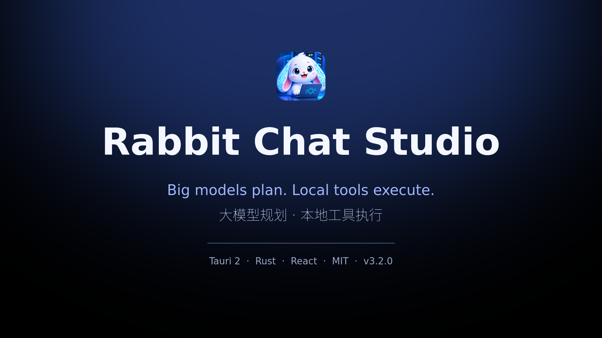

**Turn any OpenAI-compatible model into a workspace-aware desktop agent — Skills, tools, sub-agents, and a local, auditable request log.**

Rabbit Chat Studio is a Tauri 2 + Rust + React desktop client. It is not tied to a model vendor: any endpoint that speaks the OpenAI Chat Completions API can be used. Beyond chat, it gives the agent a real workspace: skills, files, commands, memory, todos, timers, MCP servers and sub-agents all operate inside one directory boundary, and every request and tool call is recorded locally.

> These pages document **Rabbit Chat Studio v3.3.3**. Every English page has a Simplified Chinese counterpart; tool names, file names and config keys stay in English in both languages.

Typical use cases:

- multi-model switching and prompt engineering;
- contextual conversations with searchable history;
- semi-automated tasks that combine local commands, files and web scraping;
- MCP integration and tool-ecosystem expansion.

## 5-minute quick start

1. **Install and launch**: on Windows, the [Microsoft Store listing](https://apps.microsoft.com/detail/9MV82J9G95GS) installs and updates it for you; otherwise download the installer for your platform from [Latest release](https://github.com/xlbbb-cn/ai-chat/releases/latest). On macOS, right-click the app → Open the first time.
2. **Configure a model**: open **Settings → API & Model**, enter the base URL and API key, click **Fetch Models From API**, pick a model and save.
3. **Choose a workspace**: open **Settings → Workspace & Profiles** and select your project directory. Rabbit Chat Studio creates a hidden `.data/` folder there for chats, skills, memory and todos.
4. **Start chatting**: type a message and press Enter; Shift+Enter inserts a newline. Enable tools from the **Tools** panel when you want the model to act on local files or run commands.

See [Quick Start](Quick-Start) for the full first-run walkthrough.

## Feature map

| What you want to do | Page |
| --- | --- |
| Install, configure an API, first chat | [Quick Start](Quick-Start) |
| Build from source, package, publish | [Installation and Build](Installation-and-Build) |
| Chat, model parameters, `@file` / `/skill` mentions, reasoning, context, drawings, PDF export | [Interface and Chat](Interface-and-Chat) |
| New/search/favorite/archive/fork sessions | [Sessions and History](Sessions-and-History) |
| Switch workspaces, understand `.data` and app data | [Workspace and Data](Workspace-and-Data) |
| Write a skill, restrict its tools and commands | [Skills](Skills) |
| Enable tools, understand risk levels and confirmations | [Tools Overview](Tools-Overview) |
| Read/write files, run commands and workspace scripts, background serve | [Files and Commands](Files-and-Commands) |
| Run slow tools, MCP calls or sub-agents in the background | [Files and Commands](Files-and-Commands#background-tasks-run_in_background), [Tools Overview](Tools-Overview#background-tool-tasks) |
| Memory, todos, delayed timers | [Memory, Todos and Timers](Memory-Todos-and-Timers) |
| Add MCP servers | [MCP Servers](MCP-Servers) |
| Configure LLM / CLI / cloud sub-agents, mission bus and planner takeover | [Sub-Agents](Sub-Agents) |
| System prompt, context compression, reasoning | [Prompts and Context](Prompts-and-Context) |
| `config.json`, profiles, export/import | [Configuration and Backup](Configuration-and-Backup) |
| Request monitor, tool logs, mission monitor | [Monitoring and Logs](Monitoring-and-Logs) |
| In-app updates and manual upgrades | [Updates](Updates) |
| Path boundaries, permissions, key safety | [Security and Boundaries](Security-and-Boundaries) |
| Code structure, commands, CI, roadmap | [Development and Architecture](Development-and-Architecture) |
| Something is broken | [FAQ](FAQ) |

## Why Rabbit Chat Studio

Chat is the easy part. Rabbit Chat Studio focuses on three things that are easy to miss: giving the agent a real workspace, giving it usable local tools, and keeping an auditable record of every call — without imposing a persona.

| Capability | **Rabbit Chat Studio** | Cherry Studio | Chatbox | LM Studio |
| --- | :---: | :---: | :---: | :---: |
| **Skill sandbox** — one skill root per workspace (`.data/skills`), root pinned to its `SKILL.md` | ✅ | ◐ agent workspaces | — | — |
| **Self-evolution** — the assistant installs/edits/deletes its own skills and keeps verified facts in a dedicated memory scope | ✅ | — | — | — |
| **Built-in agent utilities** — 4-level memory (`session` / `user` / `repo` / `evolution`), timers, todos | ✅ | ◐ scheduled tasks | — | — |
| **Agent runtime** — LLM, local CLI or remote cloud, configured in-app | ✅ | ◐ LLM agents | — | — |
| **Prompt ownership** — no default persona; your system message is the base, tool/skill guidance is appended | ✅ | ◐ assistant prompts | ◐ prompt library | ◐ per-model prompt |
| **Local request audit** — body, tokens, latency, status, errors | ✅ | ◐ history only | ◐ history only | ◐ history + server log |
| **Background execution** — slow tools, MCP calls and sub-agents keep running while the model works | ✅ | — | — | — |
| **Built-in drawing** — Mermaid, flow charts, 2D SVG and 3D scenes, saved as PNG/HTML | ✅ | — | — | — |

✅ built in · ◐ partial or adjacent · — not offered. Based on public documentation as of November 2026.

## README coverage

| README section | Where it lives here |
| --- | --- |
| Why Rabbit Chat Studio / Introduction | This page |
| Core Features → Chat | [Interface and Chat](Interface-and-Chat), [Sessions and History](Sessions-and-History) |
| Core Features → Sub-Agent Orchestration | [Sub-Agents](Sub-Agents) |
| Core Features → Skill System | [Skills](Skills) |
| Core Features → Tool System | [Tools Overview](Tools-Overview), [Files and Commands](Files-and-Commands), [Memory, Todos and Timers](Memory-Todos-and-Timers) |
| Core Features → MCP Management | [MCP Servers](MCP-Servers) |
| Core Features → Local Persistence & Operations | [Workspace and Data](Workspace-and-Data), [Configuration and Backup](Configuration-and-Backup), [Monitoring and Logs](Monitoring-and-Logs) |
| First Principles Design | [Development and Architecture](Development-and-Architecture#design-principles) |
| Tech Stack & Architecture | [Development and Architecture](Development-and-Architecture#architecture) |
| Quick Start | [Quick Start](Quick-Start) |
| Build & Installation | [Installation and Build](Installation-and-Build) |
| Configuration | [Configuration and Backup](Configuration-and-Backup) |
| Project Structure | [Development and Architecture](Development-and-Architecture#project-structure), [Workspace and Data](Workspace-and-Data) |
| Security & Boundaries | [Security and Boundaries](Security-and-Boundaries) |
| Development Roadmap | [Development and Architecture](Development-and-Architecture#roadmap) |
| License | [Development and Architecture](Development-and-Architecture#license) |

## Design principles

The core intent: reason from first principles, return freedom to the user (tools, LLM API, prompts), and keep the interface minimal and professional.

Rabbit Chat Studio reduces a desktop agent to four irreducible problems: how to reliably obtain model output, how to let the model act on the local world, how to draw clear risk boundaries, and how to keep everything reproducible and debuggable.

- **Minimal dependency closure**: model calls go through OpenAI-compatible APIs, so there is no vendor lock-in.
- **Capabilities decoupled from permissions**: chat works by default; tools are opt-in; skills can narrow them further.
- **Local-first observability**: configuration, history and request logs stay local.
- **Explicit security boundaries**: skill directory isolation, tool allowlists and workspace path constraints.
- **Replaceable architecture**: frontend, command layer, model service and graph backend are modular.

In one sentence: **the model handles cognition and planning, local tools handle execution and verification, and the application framework handles boundaries and records.**

## Conventions

- **Settings → API & Model** refers to the sections in the Settings panel.
- Paths are relative to the **current workspace root** unless stated otherwise; `./` is the workspace root.
- Commands show Windows PowerShell first; macOS/Linux differences are called out.
- Tool names, config keys and event names stay in English so they are easy to search in `config.json` and the source.

## Keeping these pages current

These docs live in the repository under `docs/wiki/` and are rendered to this site by `scripts/gen-wiki.mjs` — this site is the only maintained copy. The GitHub Wiki now holds forwarding pages that point here. Version numbers in the pages follow `package.json` (`v3.3.3` today) and the per-release entries in `CHANGELOG.md`.

## Links

- Repository: <https://github.com/xlbbb-cn/ai-chat>
- Microsoft Store: <https://apps.microsoft.com/detail/9MV82J9G95GS> (Store ID `9MV82J9G95GS`)
- Latest release: <https://github.com/xlbbb-cn/ai-chat/releases/latest>
- Changelog: <https://github.com/xlbbb-cn/ai-chat/blob/main/CHANGELOG.md>
- Issues: <https://github.com/xlbbb-cn/ai-chat/issues>
- License: MIT (see `LICENSE` in the repository)
