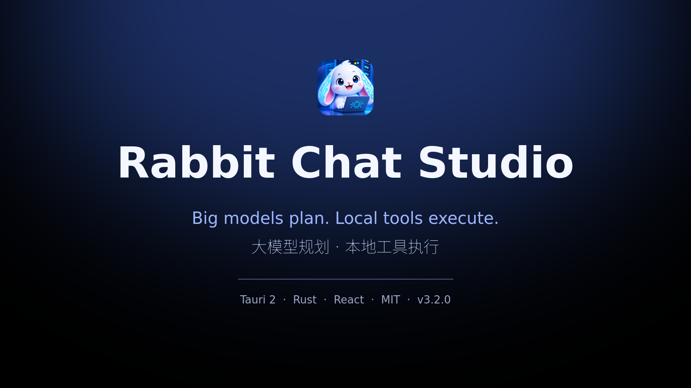

**把任意 OpenAI 兼容模型变成工作区感知的桌面智能体 —— Skills、工具、子智能体，以及一份本地可审计的请求日志。**

Rabbit Chat Studio 是一个 Tauri 2 + Rust + React 的桌面 AI 客户端。它不绑定模型厂商：只要接口兼容 OpenAI Chat Completions，就可以接入。聊天之外，它把「工作区」交给智能体：技能、文件、命令、记忆、待办、定时器、MCP 服务器和子智能体都在同一个目录边界内运行，并把每次请求与工具调用记录在本地。

> 本文档对应 **Rabbit Chat Studio v3.3.3**，是英文页面的对照翻译。英文页面为主，中文页面用于辅助阅读；代码标识符、文件名和配置键保持英文原样。

典型场景：

- 多模型切换与提示词工程；
- 带历史追踪的上下文对话；
- 组合本地命令、文件与网页抓取的半自动任务；
- MCP 服务器集成与工具生态扩展。

## 5 分钟上手

1. **安装并启动**：Windows 上直接装 [Microsoft Store 版](https://apps.microsoft.com/detail/9MV82J9G95GS)，由商店负责安装与更新；其余情况从 [Latest release](https://github.com/xlbbb-cn/ai-chat/releases/latest) 下载对应平台安装包并打开。macOS 首次启动需右键 → 打开。
2. **配置模型**：打开「设置 → API 与模型」，填写基础地址与 API 密钥，点「从 API 获取模型」，选择模型并保存。
3. **选择工作区**：在「设置 → 工作区与配置」选择你的项目目录。Rabbit Chat Studio 会在其中创建隐藏的 `.data/` 保存会话、技能、记忆和待办。
4. **开始对话**：在输入框输入消息，Enter 发送，Shift+Enter 换行。需要让模型动手时，再到「工具」里开启文件操作或命令执行。

更完整的首次配置见 [快速开始](快速开始)。

## 功能地图

| 你想做的事 | 去哪里看 |
| --- | --- |
| 安装、首次配置、接入模型 | [快速开始](快速开始) |
| 本地开发、打包、发布 | [安装与构建](安装与构建) |
| 聊天、模型参数、`@file` / `/skill` 提及、思考深度、上下文、绘图、导出 PDF | [界面与聊天](界面与聊天) |
| 新建/搜索/收藏/归档/分支会话 | [会话与历史](会话与历史) |
| 切换工作区，理解 `.data` 与应用数据目录 | [工作区与本地数据](工作区与本地数据) |
| 写一个技能，控制它的工具与命令 | [技能](技能) |
| 开启工具、理解风险等级与确认弹窗 | [工具总览](工具总览) |
| 读写文件、执行命令与工作区脚本、后台 serve | [文件与命令](文件与命令) |
| 让慢工具、MCP 调用或子智能体在后台跑 | [文件与命令](文件与命令#后台任务run_in_background)、[工具总览](工具总览#后台工具任务) |
| 记忆、待办清单、延时定时器 | [记忆待办与定时器](记忆待办与定时器) |
| 接入 MCP 服务器 | [MCP服务器](MCP服务器) |
| 配置 LLM / CLI / 云端子智能体、任务总线与规划器接管 | [子智能体](子智能体) |
| 系统提示词、上下文压缩、推理参数 | [提示词与上下文](提示词与上下文) |
| config.json、配置方案、导入导出 | [配置与备份](配置与备份) |
| 请求监控、工具日志、任务监视器 | [监控与日志](监控与日志) |
| 应用内更新与手动升级 | [更新](更新) |
| 路径边界、权限、密钥安全 | [安全与边界](安全与边界) |
| 代码结构、命令、CI、路线图 | [开发与架构](开发与架构) |
| 遇到问题 | [常见问题](常见问题) |

## 为什么是 Rabbit Chat Studio

聊天本身并不难。Rabbit Chat Studio 把重点放在三件更容易被忽略的事上：给智能体一个真实的工作区、给它一组可用的本地工具、给每次调用留下可审计的记录，同时不强调一个预设人格。

| 能力 | **Rabbit Chat Studio** | Cherry Studio | Chatbox | LM Studio |
| --- | :---: | :---: | :---: | :---: |
| **技能沙箱** —— 每个工作区**唯一**的技能根目录 `.data/skills`，根目录锚定到技能自己的 `SKILL.md` | ✅ | ◐ 智能体工作区 | — | — |
| **自我进化** —— 助手自行安装/修改/删除技能，并把已验证的关键事实存进专属记忆区 | ✅ | — | — | — |
| **内置智能体工具** —— 4 级记忆（`session` / `user` / `repo` / `evolution`）、定时器、待办 | ✅ | ◐ 计划任务 | — | — |
| **智能体运行时** —— LLM、本机 CLI 或远程云端，均在应用内配置 | ✅ | ◐ LLM 智能体 | — | — |
| **提示词所有权** —— 不注入默认人格；你的系统消息是基底，只追加工具/技能说明 | ✅ | ◐ 助手提示词 | ◐ 提示词库 | ◐ 每模型提示词 |
| **本地请求审计** —— 请求体、tokens、延迟、状态、错误 | ✅ | ◐ 仅历史 | ◐ 仅历史 | ◐ 历史 + 服务端日志 |
| **后台执行** —— 慢工具、MCP 调用与子智能体在模型继续工作时运行 | ✅ | — | — | — |
| **内置绘图** —— Mermaid、流程图、2D SVG 与 3D 场景，可另存为 PNG/HTML | ✅ | — | — | — |

✅ 内置 · ◐ 部分或相近能力 · — 未提供。基于 2026 年 11 月的公开文档。

## README 章节对照

| README 章节 | 对应页面 |
| --- | --- |
| Why Rabbit Chat Studio / Introduction | 本页 |
| Core Features → Chat | [界面与聊天](界面与聊天)、[会话与历史](会话与历史) |
| Core Features → Sub-Agent Orchestration | [子智能体](子智能体) |
| Core Features → Skill System | [技能](技能) |
| Core Features → Tool System | [工具总览](工具总览)、[文件与命令](文件与命令)、[记忆待办与定时器](记忆待办与定时器) |
| Core Features → MCP Management | [MCP服务器](MCP服务器) |
| Core Features → Local Persistence & Operations | [工作区与本地数据](工作区与本地数据)、[配置与备份](配置与备份)、[监控与日志](监控与日志) |
| First Principles Design | [开发与架构](开发与架构#设计原则) |
| Tech Stack & Architecture | [开发与架构](开发与架构#架构) |
| Quick Start | [快速开始](快速开始) |
| Build & Installation | [安装与构建](安装与构建) |
| Configuration | [配置与备份](配置与备份) |
| Project Structure | [开发与架构](开发与架构#项目结构)、[工作区与本地数据](工作区与本地数据) |
| Security & Boundaries | [安全与边界](安全与边界) |
| Development Roadmap | [开发与架构](开发与架构#路线图) |
| License | [开发与架构](开发与架构#许可) |

## 设计原则

核心初衷：从第一性原理出发，把自由还给用户（工具、LLM API、提示词），并保持界面简约、专业。

Rabbit Chat Studio 把桌面智能体拆成四个不可再分的问题：如何稳定拿到模型输出、如何让模型作用于本机、如何划清风险边界、如何保证可复现与可调试。对应的选择是：

- **最小依赖闭包**：模型调用统一走 OpenAI 兼容接口，不锁定厂商。
- **能力与权限解耦**：聊天默认可用；工具按需开启；技能可以进一步收紧工具和命令。
- **本地优先可观测**：配置、历史、请求日志都在本地，便于审计和复现。
- **显式安全边界**：技能目录隔离、工具白名单、工作区路径约束。
- **可替换架构**：前端、后端命令、模型服务都可以替换。

一句话：**大模型负责认知与规划，本地工具负责执行与验证，应用框架负责边界与记录。**

## 约定

- 文中「设置 → API 与模型」指主界面右上角「设置」中的分区。
- 路径默认相对于**当前工作区根目录**；`./` 就是工作区根目录。
- 命令示例以 Windows PowerShell 为主；macOS / Linux 的差异会单独标注。
- 工具、配置键、事件名等技术标识符保持英文，便于在 `config.json` 和代码中搜索。

## 这些页面怎么维护

文档正文放在仓库的 `docs/wiki/` 下，由 `scripts/gen-wiki.mjs` 生成本站页面，GitHub Wiki 用同一份文本同步。文中版本号跟随 `package.json`（当前 v3.3.3），每个版本的变更见 `CHANGELOG.md`。

## 相关链接

- 仓库：<https://github.com/xlbbb-cn/ai-chat>
- Microsoft Store：<https://apps.microsoft.com/detail/9MV82J9G95GS>（Store ID `9MV82J9G95GS`）
- 最新发布：<https://github.com/xlbbb-cn/ai-chat/releases/latest>
- 变更记录：<https://github.com/xlbbb-cn/ai-chat/blob/main/CHANGELOG.md>
- 问题反馈：<https://github.com/xlbbb-cn/ai-chat/issues>
- 许可证：MIT（见仓库 `LICENSE`）
